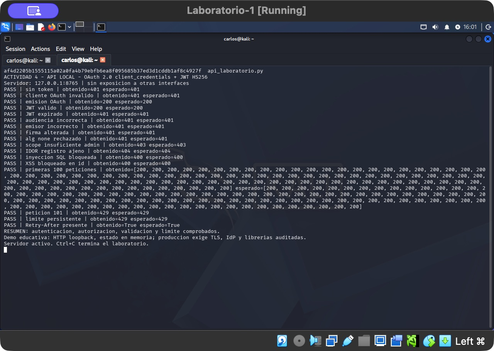
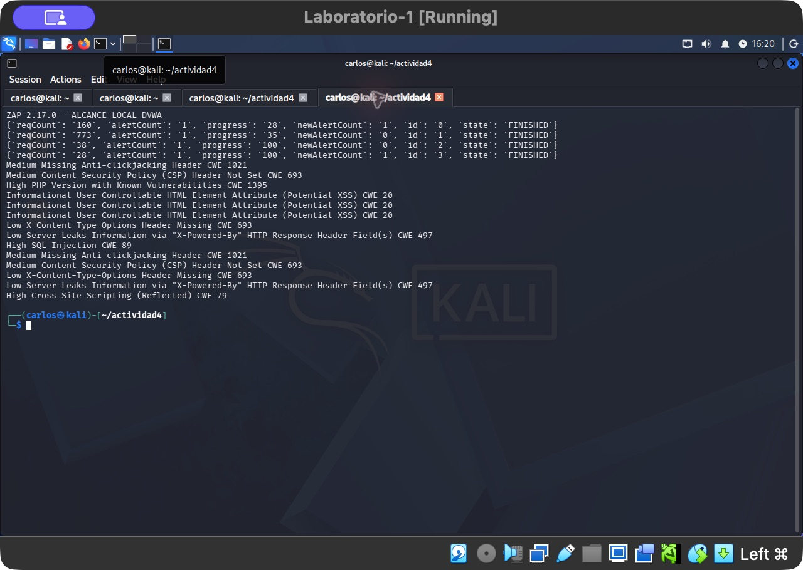
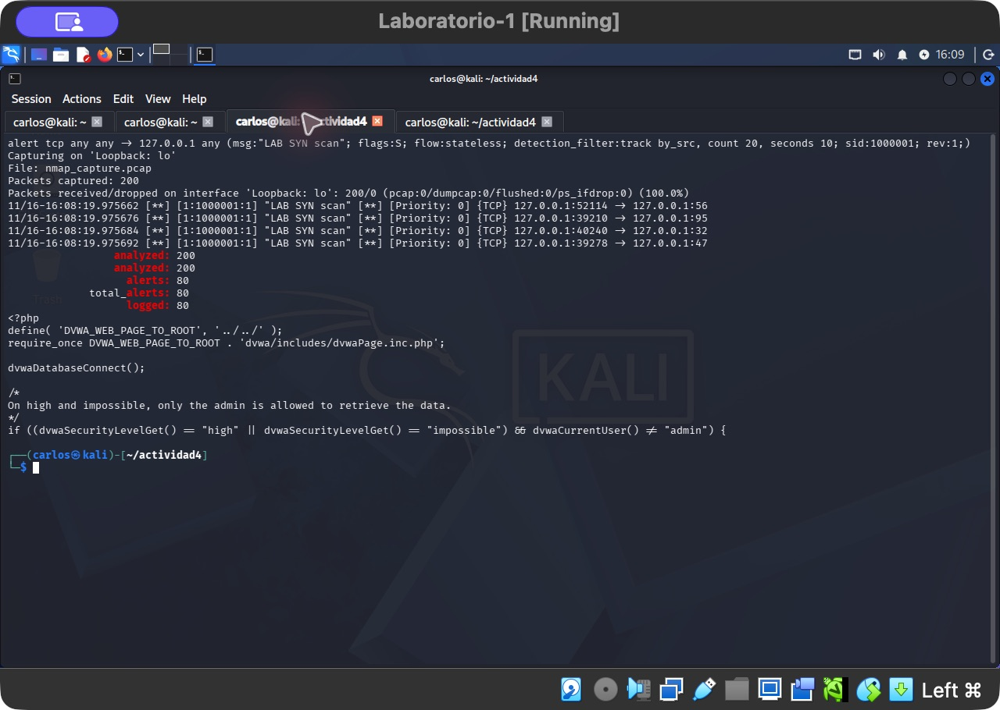

# Actividad 4 — Seguridad de aplicaciones web y API

Repositorio académico de la práctica realizada en **Kali Linux dentro de VirtualBox**, desde la perspectiva de un estudiante de **quinto semestre de Ingeniería de Software**. Incluye el informe, capturas reales, código de la API simulada, pruebas de DVWA y una regla personalizada de Snort.

**Objetivo:** identificar vulnerabilidades, comprobar controles de protección y priorizar riesgos con evidencia reproducible. Las pruebas se realizaron únicamente contra `127.0.0.1`, con datos ficticios.

## Entregables para el profesor

- **[Informe completo en Word](docs/Actividad_4_Informe_Completo.docx)**: texto editable, siete tablas y ocho capturas incorporadas. Descargar para abrir en Word o subir a Google Docs.
- **[Informe en PDF](docs/Actividad_4_Informe_Seguridad.pdf)**: 15 páginas con análisis, evidencias, matriz 5×5, recomendaciones y referencias.
- **[Versión de lectura y edición en Markdown](docs/Actividad_4_Informe_Editable.md)**.
- **[Capturas originales](evidencias/)** y **[código de la práctica](src/)**.

La versión Word contiene el mismo contenido académico; su número de páginas puede cambiar según el editor y la configuración de impresión.

## Alcance y cumplimiento

| Componente solicitado | Trabajo realizado | Estado |
| --- | --- | --- |
| DVWA y OWASP ZAP | Pruebas autenticadas de SQLi y XSS; escaneos finales al 100 % | Ejecutado |
| Tres vulnerabilidades | SQLi, XSS reflejado y autorización insuficiente en DVWA | Confirmadas en el alcance descrito |
| JWT y OAuth 2.0 | API educativa con client_credentials, JWT HS256 y verificación de permisos | Ejecutado desde terminal |
| Validación de entradas | Formato de id, parámetros SQL y propietario del recurso | Ejecutado |
| 100 solicitudes por minuto | Ventana móvil por sujeto; petición 101 devuelve 429 | Ejecutado |
| Nmap y Snort | Escaneo TCP local, captura real y análisis con regla personalizada | Detección IDS verificada |
| Firewall y filtrado | Modelo lógico con denegación por defecto y dominio ficticio | Simulación; no configura pfSense |
| pfSense y bloqueo IPS | No hubo una instancia compatible disponible | Pendiente de implementación real |
| Postman / Insomnia | Se usó el cliente HTTP de Python en terminal | Interfaz de esas herramientas no utilizada |
| Matriz de riesgos | Probabilidad × impacto; escala 5×5 y criterios de tratamiento | Documentado |
| Packet Tracer, GNS3 y diseño de red | Excluidos por indicación docente comunicada para la actividad | No realizados |

SQLi y XSS son vulnerabilidades diferentes, pero ambas pertenecen a **A03:2021 Injection**. El control de acceso corresponde a **A01:2021 Broken Access Control**. La clasificación usa expresamente la edición OWASP Top 10:2021; no se presentan como tres categorías distintas.

## Resultados observados

| Prueba | Resultado |
| --- | --- |
| DVWA SQLi | La entrada normal produjo 1 registro; la condición alterada produjo 5 |
| DVWA XSS | El script de prueba apareció sin codificar en la respuesta HTML; ZAP lo reportó como XSS reflejado |
| DVWA autorización | `gordonb`, sin rol administrador, obtuvo 5 registros en low; en high recibió `Access denied` |
| ZAP | Escaneo final 2: 38 solicitudes y 100 %; escaneo final 3: 28 solicitudes y 100 % |
| API sin token, token expirado o firma inválida | HTTP 401 |
| API con scope insuficiente | HTTP 403 |
| API con entrada SQLi o script en id | HTTP 400 |
| Recurso de otro propietario | HTTP 404 |
| Rate limiting | Primeras 100 peticiones: 200; petición 101 y siguiente: 429, con Retry-After |
| Captura de Nmap | 200 paquetes; no se informaron pérdidas |
| Snort | 200 paquetes analizados y 80 alertas con SID 1000001 |

Los escaneos iniciales 0 y 1 de ZAP se detuvieron al ajustar el alcance y la política. Los dos escaneos finales completados son los números 2 y 3. Las alertas automáticas adicionales de cabeceras o versiones requieren análisis propio antes de considerarlas vulnerabilidades explotables.

## Estructura

| Ruta | Contenido |
| --- | --- |
| `src/api_laboratorio.py` | Servidor local y verificaciones HTTP de la API |
| `src/dvwa_pruebas.py` | Preparación de la base de práctica, login, SQLi, XSS y escaneo ZAP |
| `src/dvwa_acceso.py` | Comparación de autorización low/high con usuario no administrador |
| `src/politica_simulada.py` | Simulación lógica de decisiones de firewall y DNS |
| `reglas/local.rules` | Regla Snort para ráfagas SYN |
| `scripts/capturar_y_detectar.sh` | Captura del escaneo local y análisis con Snort |
| `docs/` | Informes y explicación del laboratorio |
| `evidencias/` | Diez capturas reales; ocho incluidas en el informe |
| `requirements.txt` | Cliente HTTP requerido por las pruebas DVWA |

## Entorno utilizado

- VirtualBox, VM `Laboratorio-1`, Kali Linux **ARM64**, 2 CPU virtuales y 2 GB de RAM.
- Nmap 7.99, PHP 8.4.22, MariaDB 11.8.6, ZAP 2.17.0.
- Snort 3.12.2.0, DAQ 3.0.24, Python 3 y dumpcap.
- Paquetes de herramientas descargados del repositorio de Kali y extraídos en una carpeta de laboratorio.
- Servicios ligados únicamente a loopback: DVWA `8088`, MariaDB `3307`, ZAP `8090` y API `8765`.

Las versiones corresponden a la ejecución documentada. Los nombres de paquetes y versiones disponibles pueden cambiar; un repositorio académico no incluye los binarios de terceros.

## Ejecución rápida de la API

```bash
git clone https://github.com/Skie1sr/actividad-4-seguridad-web-api.git
cd actividad-4-seguridad-web-api
python3 -u src/api_laboratorio.py
```

Este script utiliza la biblioteca estándar de Python. Inicia el servidor en `127.0.0.1:8765` y ejecuta sus verificaciones. Al finalizar las pruebas, permanece activo para inspección; **Ctrl+C** lo detiene.

| Endpoint | Función |
| --- | --- |
| `GET /health` | Comprobación de disponibilidad |
| `POST /oauth/token` | Emisión de token para el cliente de laboratorio |
| `GET /api/records?id=1` | Recurso autenticado y limitado por propietario |
| `GET /api/admin` | Requiere scope administrativo |

La clave de firma y el secreto del cliente se generan de forma efímera en cada ejecución. No hay claves de una cuenta real en el repositorio. JWT es el formato del token; OAuth 2.0 es el marco de autorización. El flujo client_credentials representa un cliente confidencial, no un login humano.

### Controles de la API

1. Algoritmo HS256 permitido explícitamente y firma HMAC comparada en tiempo constante.
2. Verificación de emisor, audiencia y expiración; rechazo de `alg=none` y firmas alteradas.
3. Scopes por endpoint y filtro de propietario en la consulta.
4. Validación de un único id entero positivo de hasta seis dígitos y consultas parametrizadas.
5. Ventana móvil de 60 segundos por sujeto, con bloqueo de concurrencia y respuesta 429.

Es una implementación educativa, con HTTP en loopback y estado en memoria. No es un proveedor OAuth completo ni una solución de producción. El limitador no cubre la emisión de tokens, no comparte estado entre procesos y no se ejecutó una prueba de reapertura tras vencer la ventana ni una prueba de carga concurrente.

## Preparación y reproducción de DVWA, ZAP y Snort

Consultar **[la guía del laboratorio](docs/LABORATORIO.md)** para preparar dependencias, iniciar los servicios locales, ejecutar las pruebas y cerrar los procesos.

```bash
python3 -m venv .venv
source .venv/bin/activate
python -m pip install -r requirements.txt
```

Una vez iniciados DVWA, su base de datos y ZAP:

```bash
cd lab
python -u ../src/dvwa_pruebas.py | tee dvwa_resultados.txt
python ../src/dvwa_acceso.py | tee acceso_resultados.txt
```

**`dvwa_pruebas.py` usa Create / Reset Database de DVWA y reinicia sus datos de práctica. Ejecutarlo únicamente en el laboratorio desechable descrito.** No ejecutar simultáneamente dos instancias de las pruebas ni reiniciar DVWA durante un escaneo activo.

El código de apoyo integra los ajustes de sesión duplicada y espera del registro asíncrono en el árbol de sitios que se resolvieron durante la práctica. Las capturas constituyen la evidencia de la ejecución documentada; los archivos del repositorio permiten repetir el procedimiento.

## Nmap y Snort

Desde la raíz del repositorio, después de preparar las herramientas en `lab/tools`:

```bash
bash scripts/capturar_y_detectar.sh
```

La regla cuenta SYN del mismo origen y alerta después de 20 en 10 segundos. No cuenta puertos distintos: una ráfaga legítima también podría activarla. Debe ajustarse con tráfico de referencia antes de usarse operativamente.

La prueba procesa una **captura real** del escaneo local. Demuestra **detección IDS sobre PCAP**, no prevención IPS inline. Los puertos cerrados que observó Nmap no demuestran bloqueo por firewall.

## Simulación perimetral

```bash
python3 src/politica_simulada.py
```

Comprueba cuatro decisiones: negar un origen no autorizado, permitir administración limitada, bloquear `phishing.invalid` y permitir el caso de control. Usa nombres `.invalid` ficticios y no consulta dominios maliciosos reales.

La función no modifica el firewall ni configura pfSense. Tampoco hace filtrado real de contenido ni prueba la aplicación de reglas a paquetes. El despliegue real de pfSense, su integración con Snort y el modo IPS quedaron pendientes. La documentación consultada indica amd64 para hardware de terceros; la VM disponible era ARM64.

## Evidencias

| Captura | Proceso |
| --- | --- |
| [01 — Inventario](evidencias/01_inventario.png) | Herramientas iniciales y servicios |
| [02 — VirtualBox](evidencias/02_virtualbox.png) | Máquina virtual disponible |
| [03 — API](evidencias/03_api_pruebas.png) | Autenticación, permisos, entradas y límite |
| [04 — DVWA](evidencias/04_dvwa_sqli_xss.png) | SQLi y respuesta XSS |
| [05 — Reconocimiento](evidencias/05_nmap_snort_version.png) | Nmap y versión de Snort |
| [06 — Estadísticas](evidencias/06_snort_estadisticas.png) | Paquetes analizados y alertas |
| [07 — Regla y alertas](evidencias/07_snort_regla_alertas.png) | Captura y SID personalizado |
| [08 — Autorización](evidencias/08_dvwa_acceso.png) | Usuario ordinario en low y high |
| [09 — ZAP](evidencias/09_zap_resultados.png) | Escaneos finales y alertas |
| [10 — Política](evidencias/10_politica_simulada.png) | Simulación explícita de reglas |

### Vista previa de los resultados







## Evaluación de riesgos y estándares

El informe usa una matriz ordinal **R = probabilidad × impacto**, con escalas de 1 a 5. Bandas: 1–4 bajo, 5–9 medio, 10–16 alto, 17–25 crítico. Las puntuaciones priorizan un escenario académico y no representan pérdidas económicas ni frecuencia observada.

| Escenario | P | I | R | Tratamiento principal |
| --- | --- | --- | --- | --- |
| SQLi | 4 | 5 | 20 | Parametrización y privilegios mínimos de BD |
| XSS | 4 | 4 | 16 | Codificación contextual y CSP |
| Control de acceso roto | 4 | 4 | 16 | Autorización por endpoint y recurso |
| JWT mal validado, escenario hipotético | 4 | 5 | 20 | Firma, claims, scopes y claves |
| Reconocimiento con escaneo | 3 | 3 | 9 | Detección y revisión de eventos |
| Phishing, escenario hipotético | 3 | 4 | 12 | Filtrado actualizado y control de salida DNS |

La relación con NIST AC-3, SI-10 y SI-4 se propone como correspondencia técnica. ISO/IEC 27001 fundamenta la gestión de riesgos. El trabajo no constituye una certificación ni una auditoría de conformidad.

## Uso de IA

La IA apoyó los escenarios de ataque, el código educativo y la redacción. El informe distingue resultados observados, impacto potencial, controles propuestos y simulaciones. La evidencia no se reemplaza con resultados inventados.

## Referencias

- [OWASP Top 10:2021](https://top10.owasp.org/2021/).
- [DVWA y su documentación oficial](https://github.com/digininja/DVWA).
- [ZAP: Scope](https://www.zaproxy.org/docs/desktop/start/features/scope/).
- [IETF RFC 8725: JWT Best Current Practices](https://www.rfc-editor.org/rfc/rfc8725.html).
- [IETF RFC 6749: OAuth 2.0](https://www.rfc-editor.org/rfc/rfc6749.html).
- [NIST SP 800-53 Rev. 5](https://doi.org/10.6028/NIST.SP.800-53r5).
- [Snort: detection_filter](https://docs.snort.org/rules/options/post/detection_filter).
- [Netgate: fundamentos de reglas](https://docs.netgate.com/pfsense/en/latest/firewall/fundamentals.html).
- [Netgate: DNS Host Overrides](https://docs.netgate.com/pfsense/en/latest/services/dns/resolver-host-overrides.html).
- [Netgate: requisitos mínimos](https://docs.netgate.com/pfsense/en/latest/hardware/minimum-requirements.html).
- [ISO/IEC 27001](https://www.iso.org/standard/27001).

## Estado de los archivos originales

Los registros completos y el PCAP de la ejecución permanecen dentro de la VM, en `/home/carlos/actividad4`. Este repositorio incluye informes, capturas y código de apoyo; no incluye una imagen de Kali, el directorio de la base de datos ni los paquetes de terceros. Al finalizar la sesión se detuvieron los servicios temporales y se comprobó la ausencia de servicios TCP escuchando.
