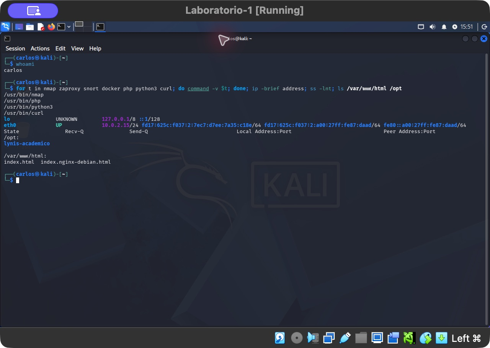
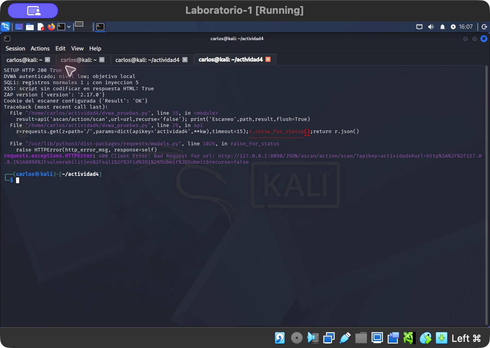
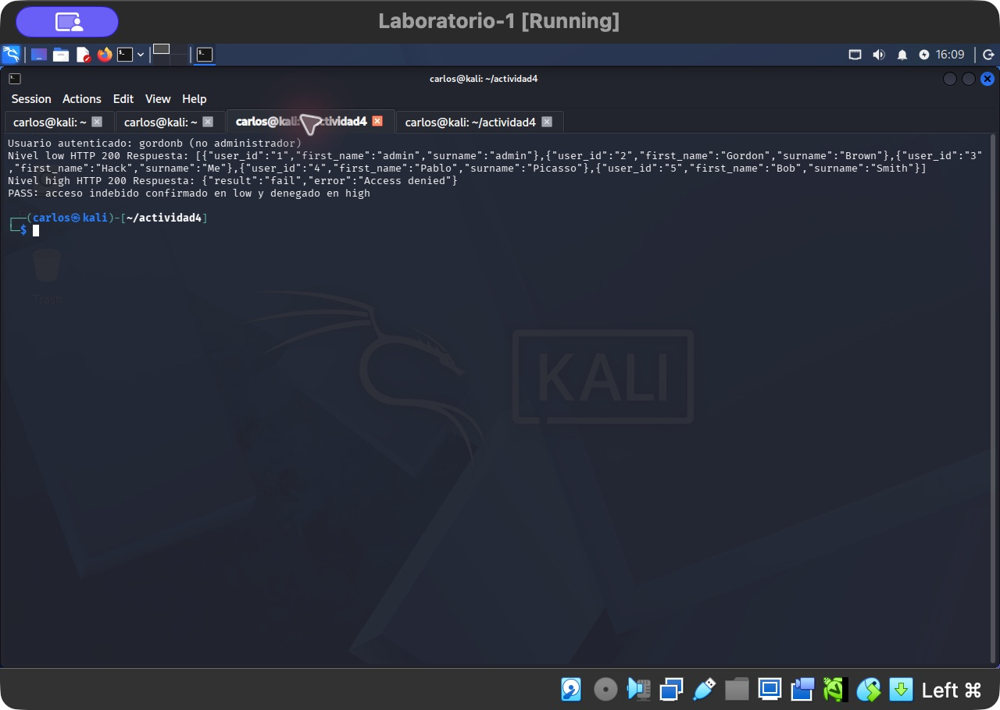
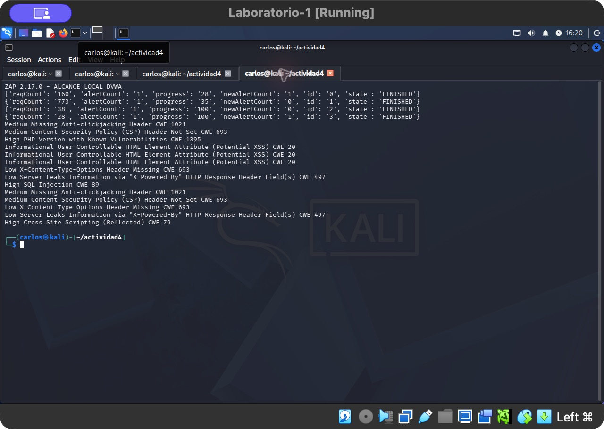
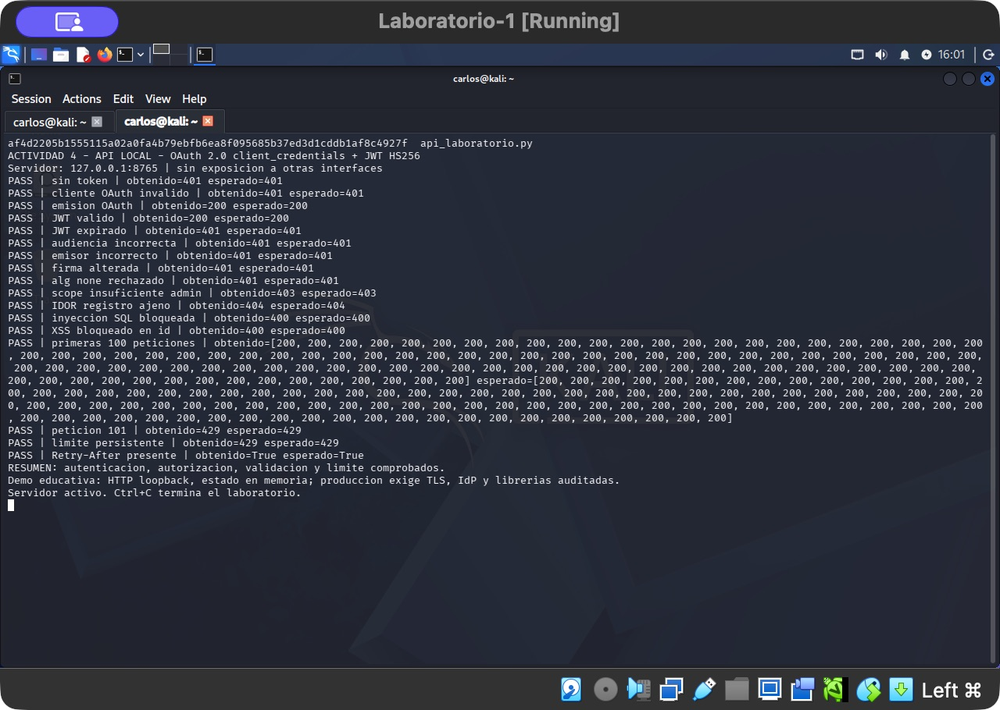
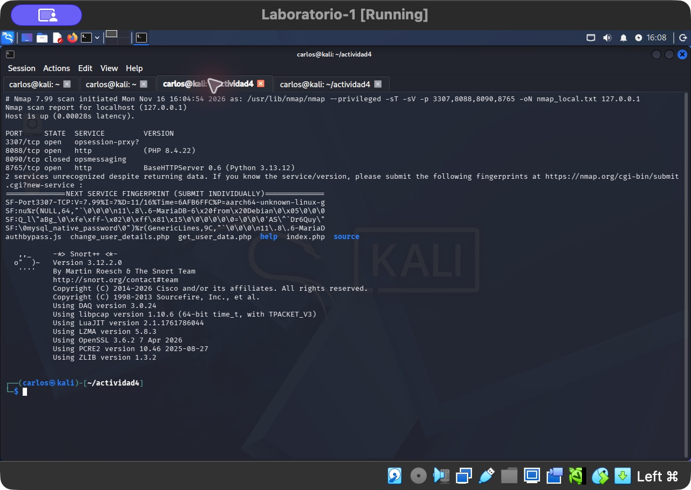
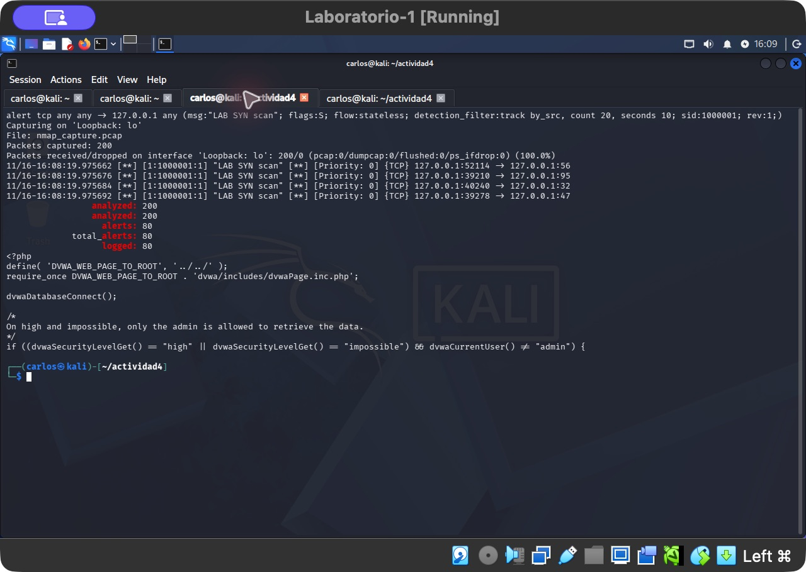
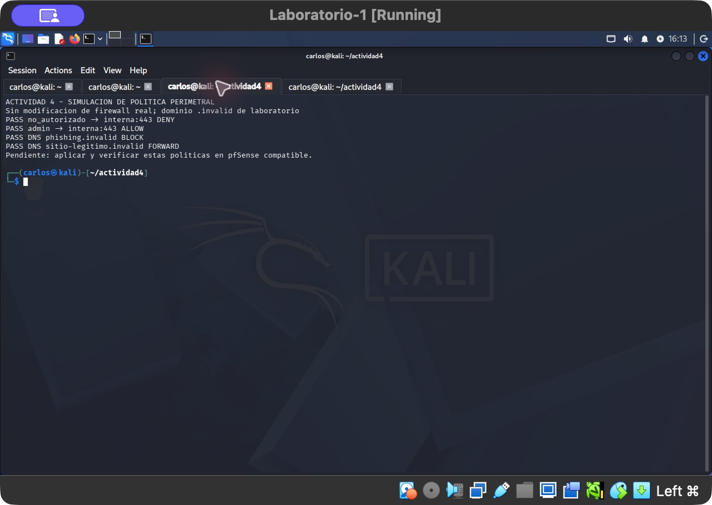

# Actividad 4
Evaluación de seguridad

Informe técnico de laboratorio | Ingeniería de Software | 5.º semestre

16 de noviembre de 2026

## Propósito

Analizar vulnerabilidades de una aplicación web, proteger una API simulada y evaluar mecanismos de detección. Relacioné los resultados con riesgos para la confidencialidad, integridad y disponibilidad, y propuse controles verificables.

## Resultados principales

| Área | Resultado observado |
| --- | --- |
| DVWA | SQLi: de 1 a 5 registros; XSS reflejado; acceso indebido con usuario sin rol administrador. |
| API local | OAuth 2.0 y JWT; rechazos 401/403/400 y límite de 100 solicitudes por minuto con respuesta 429. |
| Nmap y Snort | Captura de 200 paquetes; 80 alertas de la regla personalizada al analizar el escaneo real. |
| Perímetro | Política de bloqueo y filtrado comprobada en simulación lógica. pfSense no fue desplegado. |

Alcance académico: excluí íntegramente el diseño de red, Packet Tracer, GNS3, las VLAN y la VPN, siguiendo la indicación del docente comunicada para esta actividad. Las pruebas se limitaron al equipo virtual y a 127.0.0.1.

La IA apoyó la generación de escenarios, código de práctica y redacción. La interpretación distingue las pruebas ejecutadas de las simulaciones y de las medidas pendientes de implementar.

# 1. Entorno y metodología

Trabajé en «Laboratorio-1», con Kali Linux ARM64, 2 procesadores virtuales y 2 GB de RAM. Primero revisé las herramientas y los servicios; después preparé las aplicaciones únicamente en loopback.

| Componente | Preparación y uso |
| --- | --- |
| DVWA 2.5 | Paquete de Kali extraído en la carpeta de práctica; PHP 8.4.22 en 127.0.0.1:8088. |
| Base de datos | MariaDB 11.8.6 con directorio exclusivo de laboratorio y puerto 3307 en loopback. |
| ZAP 2.17.0 | Ejecución Java en modo daemon; API y proxy locales en el puerto 8090. |
| API Python | Endpoint académico en 127.0.0.1:8765; pruebas HTTP automatizadas desde terminal. |
| IDS | Snort 3.12.2.0 y DAQ 3.0.24; captura real mediante dumpcap. |

Secuencia: inventario → reconocimiento → pruebas web y de API → captura y detección → priorización → recomendaciones. Todos los datos de prueba fueron ficticios.

# 2. Escenarios de ataque con IA

Prompt de trabajo: «Genera un escenario de ataque a una API que use inyección SQL y JWT mal configurado. Incluye vector de ataque, impacto y dos recomendaciones de mitigación». Extendí el análisis a tres técnicas, sin asumir que un escenario generado constituye evidencia de explotación.

## Escenario A. Inyección SQL

Técnica y vector: manipular el parámetro id de una consulta para modificar su condición SQL. Motivación: obtener datos fuera del resultado autorizado. Impacto estimado: exposición de la tabla consultada; en un sistema con permisos excesivos también podría afectarse la integridad. Clasificación: CWE-89; A03:2021 Inyección. Controles relacionados: validación de entradas y consultas parametrizadas, NIST SI-10 [1, 2, 6].

Mitigaciones: (1) separar instrucciones y valores mediante parámetros; (2) limitar los permisos de la cuenta de base de datos. La reproducción local de DVWA confirmó la lectura adicional de registros.

## Escenario B. XSS reflejado

Técnica y vector: un enlace con un parámetro que contiene JavaScript se refleja en HTML sin codificación. Motivación: ejecutar acciones en el navegador de la víctima o engañarla con una interfaz falsa. Impacto potencial: manipulación del contenido y acciones con la sesión activa. Clasificación: CWE-79; A03:2021. Controles: validación y codificación contextual, SI-10 [2, 6].

Mitigaciones: (1) codificar la salida para el contexto HTML o JavaScript; (2) aplicar una política CSP como defensa adicional. La prueba local verificó el reflejo sin codificar, sin ejecutar robo de sesiones.

## Escenario C. Abuso de JWT y privilegios

Técnica y vector: presentar un token alterado, expirado o con alg=none a un endpoint sin validación estricta. Motivación: suplantar una identidad o acceder a funciones administrativas. Impacto estimado: lectura o modificación de recursos protegidos. Clasificación: fallas de autenticación y control de acceso; RFC 8725 y NIST AC-3 [3, 4, 6].

Mitigaciones: (1) fijar algoritmos permitidos y validar firma, emisor, audiencia y expiración; (2) verificar scopes y propiedad de cada recurso. En la API protegida, los casos inválidos fueron rechazados.

# 3. DVWA: SQLi y XSS

Autentiqué una sesión de laboratorio y seleccioné el nivel low para reproducir las vulnerabilidades previstas en DVWA. Primero probé una entrada válida y luego una entrada de ataque; conservé las respuestas HTML para revisar los resultados.

## Hallazgo H01. SQLi confirmada

GET /vulnerabilities/sqli/ | id=1' OR '1'='1 | Submit=Submit

La consulta id=1 mostró un registro y la condición alterada mostró cinco. El resultado confirma que la entrada modificó el alcance de la consulta. No se realizaron cambios destructivos. Riesgo principal: pérdida de confidencialidad; prioridad crítica en el escenario evaluado.

## Hallazgo H02. XSS reflejado confirmado en la respuesta

GET /vulnerabilities/xss_r/ | name=

El cuerpo HTML devolvió exactamente el script sin codificar. Esta evidencia demuestra la reflexión insegura; no acredita por sí sola robo de cookies ni ejecución en un navegador. Para cerrar esa segunda comprobación debe registrarse la ejecución controlada del marcador en un navegador.

# 4. DVWA: control de acceso

Para evitar confundir autenticación con autorización, inicié sesión con gordonb, un usuario de prueba sin rol administrador, y consulté directamente el endpoint de datos de usuarios.

## Hallazgo H03. Autorización insuficiente

GET /vulnerabilities/authbypass/get_user_data.php

En low, el endpoint devolvió cinco registros de usuarios. En high devolvió un objeto con error «Access denied». Ambos casos respondieron HTTP 200: la denegación debe interpretarse por el cuerpo de la respuesta; no se observó un HTTP 403 en ese módulo de DVWA.

El archivo revisado implementa la restricción de administrador en high e impossible. La comparación respalda que ocultar una opción de menú no reemplaza la verificación de permisos en el servidor. Clasificación: OWASP A01:2021, control de acceso roto [3].

Mitigación: autorización centralizada por rol y por recurso en cada solicitud, denegación por defecto y pruebas con usuarios de distintos privilegios. En una API propia, una denegación de permisos debe representarse de forma consistente mediante 403 o una política documentada de ocultación con 404.

# 5. Escaneo autenticado con ZAP

Usé el proxy y la API local de ZAP para registrar los módulos SQLi y XSS. Configuré una regla de reemplazo del encabezado Cookie con la sesión autenticada y el nivel de práctica. El alcance se restringió a los módulos locales de DVWA [7].

Los escaneos finales 2 y 3 llegaron al 100 %, con 38 y 28 solicitudes, respectivamente. ZAP reportó SQL Injection (CWE-89) y Cross Site Scripting Reflected (CWE-79) con riesgo alto. Los escaneos iniciales 0 y 1 fueron detenidos al ajustar la política. Las alertas finales se contrastaron con las pruebas manuales; el control de acceso se verificó comparando roles.

Los avisos de una herramienta son indicios que requieren validación. Una alerta de cabecera ausente no prueba por sí sola una explotación; la severidad automática tampoco reemplaza la evaluación de impacto sobre el activo.

Evidencia en Kali: dvwa_resultados.txt, zap_alertas.json, sqli_response.html y xss_response.html.

# 6. API: autenticación y permisos

Implementé un endpoint académico con OAuth 2.0 client_credentials y tokens JWT HS256. El cliente se autentica en /oauth/token y recibe un token de cinco minutos; el servidor verifica algoritmo, firma, iss, aud, exp y scope antes de permitir el acceso [4, 5].

JWT es un formato de token; OAuth 2.0 define un marco de autorización. Aquí client_credentials representa una aplicación cliente confidencial, no el inicio de sesión de un usuario humano. Las solicitudes se ejecutaron con el cliente HTTP del programa en terminal; no se utilizó la interfaz de Postman o Insomnia.

El servicio quedó limitado a loopback y usó HTTP para esta demostración local. No es una implementación productiva ni una declaración de conformidad completa con OAuth: para producción se requieren TLS, un proveedor de identidad, bibliotecas auditadas y gestión formal de claves y revocación.

# 7. API: validación y rate limiting

| Prueba | Esperado | Observado |
| --- | --- | --- |
| Sin token / cliente OAuth inválido | 401 | 401 / 401 |
| Cliente OAuth válido / JWT válido | 200 | 200 / 200 |
| Token expirado, firma alterada o alg=none | 401 | 401 en los tres casos |
| Emisor o audiencia incorrectos | 401 | 401 / 401 |
| Scope insuficiente en /api/admin | 403 | 403 |
| Registro de otro propietario | 404 | 404 |
| id con SQLi / etiqueta script | 400 | 400 / 400 |
| Primeras 100 solicitudes de la ventana | 200 | 100 respuestas 200 |
| Solicitud 101 y siguiente | 429 | 429 / 429 |
| Cabecera Retry-After | Presente | Presente |

## Validación y acceso a datos

El parámetro id admite únicamente un entero positivo de hasta seis dígitos y un solo valor. La consulta utiliza parámetros SQL e incluye el propietario del recurso. La validación reduce entradas inesperadas; la parametrización evita que los valores se interpreten como instrucciones SQL. Son controles complementarios.

## Límite de solicitudes

Implementé una ventana móvil de 60 segundos por sujeto autenticado, protegida con un bloqueo de concurrencia. Antes de la prueba de carga se limpió el contador del entorno de prueba para medir el límite desde cero. El intento 101 recibió 429 y Retry-After. No se ejecutó una prueba específica de reapertura al vencer la ventana ni una prueba de carga concurrente.

El estado del limitador reside en memoria: al reiniciar se pierde y no se comparte entre procesos. Una solución distribuida requiere un almacén común y límites también en la emisión de tokens; ese endpoint no está cubierto por el limitador de esta práctica.

# 8. Reconocimiento de servicios

Ejecuté Nmap contra una lista explícita de puertos de 127.0.0.1. La finalidad fue comprobar la superficie del laboratorio antes de efectuar la captura, sin explorar otros equipos ni rangos de red.

nmap -sT -sV -p 3307,8088,8090,8765 127.0.0.1 -oN nmap_local.txt

Se observaron abiertos los puertos 3307, 8088 y 8765. El puerto 8090 aparece cerrado en esta captura inicial porque ZAP aún estaba arrancando; posteriormente su API respondió y completó los escaneos de la sección 5. Una observación de puerto cerrado no debe generalizarse como un bloqueo persistente.

Nmap identificó el servicio HTTP de PHP y el servidor Python; para otros resultados produjo firmas sin identificación concluyente. La enumeración informa exposición de servicios, pero no demuestra por sí misma que exista una vulnerabilidad explotable.

# 9. Nmap y detección con Snort

Capturé tráfico de loopback durante un escaneo TCP connect contra los puertos 1 a 100 del propio Kali. Después procesé esa captura real con Snort y una regla personalizada que alerta después de 20 SYN de un mismo origen en 10 segundos [8].

dumpcap -i lo -a duration:10 -w nmap_capture.pcap
nmap -sT -p 1-100 -T4 127.0.0.1 -oN nmap_ids.txt

Resultado: 200 paquetes capturados, sin pérdidas informadas; 200 paquetes analizados y 80 alertas. El umbral cuenta SYN por origen, no destinos distintos: también puede detectar una ráfaga de conexiones legítimas. Requiere ajuste y revisión de falsos positivos.

Esta validación corresponde a IDS sobre una captura. No se instaló Snort dentro de pfSense ni se activó un camino IPS inline; no se atribuye bloqueo de paquetes a este resultado. Los 100 puertos cerrados que reportó Nmap no prueban bloqueo por firewall.

# 10. Política perimetral simulada

Preparé y ejecuté un modelo lógico de autorización hacia la red interna y filtrado por nombre de dominio. Este modelo comprueba decisiones de política; no configura interfaces, rutas ni un firewall real.

## Reglas propuestas para un despliegue pfSense

En la interfaz por la que ingrese el tráfico: permitir primero al origen de administración autorizado únicamente el servicio necesario; bloquear y registrar los accesos restantes hacia los destinos internos protegidos. El orden debe revisarse porque pfSense utiliza la primera coincidencia de reglas en interfaz [9].

Para el ejercicio de filtrado, utilizar phishing.invalid como dominio ficticio y resolverlo a una respuesta de bloqueo. En una implantación real se requiere una lista mantenida y controles de salida DNS. Un override de DNS por sí solo puede evadirse y no equivale a filtrado completo de contenido [10].

Pendiente real: desplegar pfSense en hardware o virtualización compatibles y verificar sus registros. La VM disponible es ARM64 y no existe una instancia pfSense; la documentación de Netgate exige amd64 en hardware no vendido por Netgate [11]. Por ello no se presentan capturas ficticias de su consola.

# 11. Evaluación de riesgos: matriz 5×5

Utilicé R = probabilidad × impacto. Es una estimación ordinal para priorizar el escenario académico; no equivale a una frecuencia medida ni a pérdidas económicas calculadas. La probabilidad corresponde a una aplicación vulnerable accesible al actor descrito, no al aislamiento de loopback del laboratorio.

| P / I | 1 | 2 | 3 | 4 | 5 |
| --- | --- | --- | --- | --- | --- |
| 5 - Muy probable | 5 | 10 | 15 | 20 | 25 |
| 4 - Probable | 4 | 8 | 12 | 16 | 20 |
| 3 - Posible | 3 | 6 | 9 | 12 | 15 |
| 2 - Poco probable | 2 | 4 | 6 | 8 | 10 |
| 1 - Rara | 1 | 2 | 3 | 4 | 5 |

Impacto: 1 menor; 2 limitado; 3 moderado; 4 grave; 5 crítico. Probabilidad: 1 exige condiciones excepcionales; 2 exige varias condiciones; 3 es plausible; 4 es fácil de reproducir; 5 es recurrente o prácticamente seguro en el escenario. Bandas: 1-4 bajo; 5-9 medio; 10-16 alto; 17-25 crítico.

| Riesgo | P | I | R | Justificación |
| --- | --- | --- | --- | --- |
| H01 SQLi | 4 | 5 | 20 | Entrada manipulable; lectura adicional reproducida. |
| H02 XSS | 4 | 4 | 16 | Reflejo inseguro; ejecución requiere navegador/víctima. |
| H03 Acceso indebido | 4 | 4 | 16 | Usuario ordinario obtiene datos de usuarios. |
| H04 JWT mal validado | 4 | 5 | 20 | Escenario de suplantación; protegido en la API probada. |
| H05 Escaneo | 3 | 3 | 9 | Reconocimiento detectado; no demuestra compromiso. |
| H06 Phishing | 3 | 4 | 12 | Escenario hipotético para justificar filtrado. |

La prioridad de corrección es SQLi y validación de identidad; después autorización y XSS. El escaneo orienta investigación y monitoreo. Las puntuaciones de H04 y H06 son escenarios, no hallazgos explotados en la API protegida.

# 12. Tratamiento y prácticas de protección

| Riesgo | Acción y responsable propuesto | Criterio de cierre |
| --- | --- | --- |
| H01 SQLi | Desarrollo: parametrizar consultas y reducir privilegios de BD. | El payload no amplía resultados; entrada inválida rechazada. |
| H02 XSS | Desarrollo: codificar por contexto y añadir CSP. | El marcador se visualiza como texto; no ejecuta script. |
| H03 Acceso | Backend: validar rol y propiedad por endpoint. | Usuario ordinario no obtiene datos administrativos. |
| H04 JWT | Backend/identidad: algoritmo fijo, claims y scopes; claves seguras. | 401 para token inválido y 403 para permiso insuficiente. |
| H05 Escaneo | Operación: integrar sensor, centralizar eventos y ajustar umbrales. | Alerta correlacionada; pruebas de tráfico legítimo sin ruido excesivo. |
| H06 Phishing | Operación: filtrado actualizado y protección de salida DNS. | Dominio de prueba bloqueado y sitio permitido accesible. |

## Tres configuraciones evaluadas

1. Identidad y autorización: JWT estricto, scopes y propiedad. Relación técnica propuesta con NIST AC-3 (aplicación del control de acceso). Evidencia: pruebas de API y comparación low/high de DVWA [6].

2. Protección de entradas y datos: lista de formatos admitidos y parámetros SQL. Relación con NIST SI-10 (validación de entradas). Evidencia: 400 ante SQLi y script, y lectura de datos acotada al propietario [6].

3. Monitoreo de amenazas: regla de Snort y revisión de la captura. Relación con NIST SI-4 (monitoreo del sistema). Evidencia: SID 1000001 y 80 alertas; integración operativa pendiente [6].

ISO/IEC 27001:2022 fundamenta la gestión de riesgos y la protección de confidencialidad, integridad y disponibilidad. Estas correspondencias son una interpretación técnica del laboratorio y no una auditoría de conformidad ni una certificación ISO [12].

# 13. Conclusiones y revisión de entrega

Como estudiante de quinto semestre, el aprendizaje principal fue diferenciar encontrar una vulnerabilidad, reproducirla y comprobar una mitigación. La comparación de DVWA mostró que una sesión válida no garantiza autorización. La API mostró que bloquear entradas y validar tokens requiere pruebas tanto de aceptación como de rechazo.

La evidencia de Snort demostró la detección de un patrón de reconocimiento en tráfico real. No permite concluir que exista prevención inline. La defensa debe combinar controles de desarrollo, permisos, límites de consumo y monitoreo, con criterios de cierre medibles.

| Criterio de la rúbrica | Evidencia incluida |
| --- | --- |
| Ataques con IA - 20 puntos | Tres escenarios con técnica, vector, motivación, impacto y referencias. |
| Identificación - 25 puntos | Nmap, ZAP y tres vulnerabilidades reproducidas; capturas y explicación. |
| Protección - 20 puntos | Tres configuraciones evaluadas y recomendaciones vinculadas con controles. |
| Informe - 20 puntos | Análisis, capturas, tablas, priorización, recomendaciones y conclusión. |
| Herramientas/referencias - 15 puntos | ZAP, Nmap, Snort, clientes HTTP; ISO, NIST, OWASP e IETF. |

## Aspectos que aún requieren validación

La instalación y las reglas reales de pfSense, su integración con Snort y una prueba IPS no se completaron. La interfaz de Postman/Insomnia tampoco se utilizó. La simulación y el cliente HTTP de terminal se identifican expresamente para que el docente evalúe su equivalencia; no se presume que sustituyan automáticamente estos requisitos.

No se incluye la parte de diseño de red por la indicación docente. La valoración final corresponde al profesor; esta revisión de cobertura no asigna ni garantiza una calificación.

# 14. Referencias verificables

[1] OWASP. Top 10:2021. Edición usada para mantener estable la clasificación del informe. https://top10.owasp.org/2021/

[2] OWASP. A03:2021 - Injection. https://top10.owasp.org/2021/A03_2021-Injection/

[3] OWASP. A01:2021 - Broken Access Control. https://top10.owasp.org/2021/A01_2021-Broken_Access_Control/

[4] IETF. RFC 8725: JSON Web Token Best Current Practices. https://www.rfc-editor.org/rfc/rfc8725.html

[5] IETF. RFC 6749, sección 4.4: Client Credentials Grant. https://www.rfc-editor.org/rfc/rfc6749.html

[6] NIST. SP 800-53 Rev. 5: Security and Privacy Controls for Information Systems and Organizations. https://doi.org/10.6028/NIST.SP.800-53r5

[7] ZAP. Scope; Active Scan. https://www.zaproxy.org/docs/desktop/start/features/scope/ y https://www.zaproxy.org/docs/desktop/ui/tabs/ascan/

[8] Snort. Rule Writing Guide: detection_filter. https://docs.snort.org/rules/options/post/detection_filter

[9] Netgate. Firewall Fundamentals. https://docs.netgate.com/pfsense/en/latest/firewall/fundamentals.html

[10] Netgate. DNS Resolver: Host Overrides. https://docs.netgate.com/pfsense/en/latest/services/dns/resolver-host-overrides.html

[11] Netgate. Minimum Hardware Requirements. https://docs.netgate.com/pfsense/en/latest/hardware/minimum-requirements.html

[12] ISO. ISO/IEC 27001:2022 - Information security management systems. https://www.iso.org/standard/27001

[13] DVWA. Repositorio y documentación oficial. https://github.com/digininja/DVWA

Consulta de referencias: 16 de noviembre de 2026. Las capturas son del laboratorio observado; los relojes de la VM conservan su configuración original.